# TP2 — Découverte de services avec Eureka

**Auteur : Ossama Elmansouri**
Module : Architecture microservices (Pr. Ahaidous), 2026/2027

## Objectif

Remplacer la cible statique de la gateway (`http://localhost:8081`) par une destination **découverte** : Eureka devient le registre des services, et la gateway trouve `customer-service` à partir de son nom logique.

```
                   inscription + heartbeats
customer-service ─────────────────────────────► discovery-server (Eureka :8761)
   (:8081)                                              ▲
      ▲                                                 │ lecture du registre
      │ appel HTTP direct                               │
      └──────────── api-gateway (:8080) ────────────────┘
                    route Path=/api/customers/**  →  lb://customer-service
client ──HTTP──►
```

Eureka n'est pas un proxy : le trafic métier va directement de la gateway vers l'instance choisie par Spring Cloud LoadBalancer.

- Point de départ : état final du TP1 (`tp1/`, équivalent à `feature/step-02-gateway-static`).
- Versions : Java 21, Spring Boot 4.0.8, Spring Cloud 2025.1.2.

## Travail réalisé

| Section | Fichier | Modification |
|---|---|---|
| 4 | `pom.xml` (racine) | Ajout du module `services/discovery-server` |
| 4 | `services/discovery-server/pom.xml` | Starter `spring-cloud-starter-netflix-eureka-server`, sans version individuelle |
| 4 | `.../discoveryserver/DiscoveryServerApplication.java` | `@SpringBootApplication` + `@EnableEurekaServer` |
| 4 | `services/discovery-server/src/main/resources/application.yml` | Port 8761, `register-with-eureka: false`, `fetch-registry: false` |
| 6 | `services/customer-service/pom.xml` | Starter `spring-cloud-starter-netflix-eureka-client` |
| 6 | `customer-service/.../application.properties` | `eureka.client.service-url.defaultZone=http://localhost:8761/eureka/` |
| 7 | `services/api-gateway/pom.xml` | Starter Eureka Client (apporte LoadBalancer) |
| 7 | `api-gateway/.../application.yml` | `uri: lb://customer-service` (route, prédicat et filtre inchangés) + bloc `eureka.client` |
| 9 | `api-gateway/.../application.yml` | Option Locator : `discovery.locator.enabled: true`, `lower-case-service-id: true` |
| — | `customer-service` et `api-gateway` | `eureka.instance.prefer-ip-address=true` (voir « Dépannage rencontré ») |
| — | `scripts/test-tp2.sh` | Vérifications automatiques, phase `explicite` (sections 5 à 8) et phase `locator` (section 10) |

L'historique Git suit les étapes : un commit pour Eureka et la route `lb://`, un pour l'option Locator, un pour le correctif `prefer-ip-address`.

## Exécution

Depuis `tp2/`, dans cet ordre, un terminal par service :

```bash
./mvnw -pl services/discovery-server spring-boot:run      # 1. Eureka   :8761
./mvnw -pl services/customer-service spring-boot:run      # 2. service  :8081
./mvnw -pl services/api-gateway spring-boot:run           # 3. gateway  :8080
```

Tableau de bord Eureka : http://localhost:8761

Tests :

```bash
# Sections 5 à 8 : gateway lancée sans le Locator
./mvnw -pl services/api-gateway spring-boot:run \
  -Dspring-boot.run.arguments=--spring.cloud.gateway.server.webflux.discovery.locator.enabled=false
bash scripts/test-tp2.sh explicite

# Section 10 : gateway relancée avec la configuration finale (Locator activé)
bash scripts/test-tp2.sh locator
```

## Résultats obtenus (exécution du 19/11/2026)

### Sections 5 à 8 : route explicite `lb://customer-service`

| Vérification | Résultat |
|---|---|
| `GET /eureka/apps` avant les clients | `200`, registre vide |
| `GET /eureka/apps/CUSTOMER-SERVICE` | `200`, `status: UP`, port `8081` |
| `GET /eureka/apps/API-GATEWAY` | `200`, `status: UP` |
| `POST /api/customers` via 8080 | `201`, `Location`, `X-Served-By: api-gateway` |
| `GET /api/customers` via 8080 et en direct sur 8081 | `200`, même liste |
| `/actuator/gateway/routes` | `uri: lb://customer-service` |

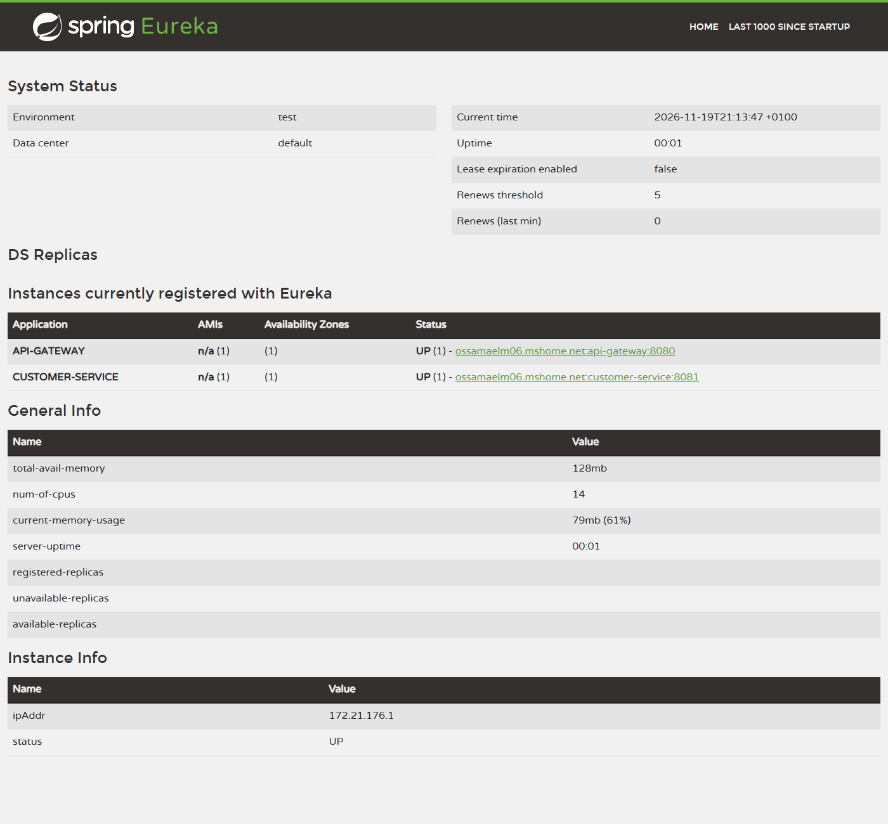

*Tableau de bord Eureka : API-GATEWAY et CUSTOMER-SERVICE sont UP.*

| Capture | Contenu |
|---|---|
| 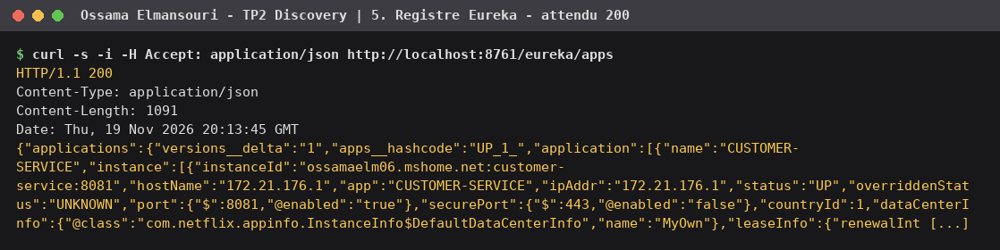 | Registre Eureka (API REST) |
| 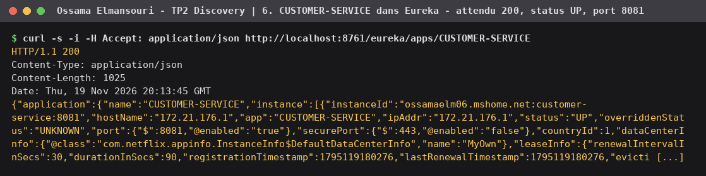 | CUSTOMER-SERVICE inscrit, UP, port 8081 |
| 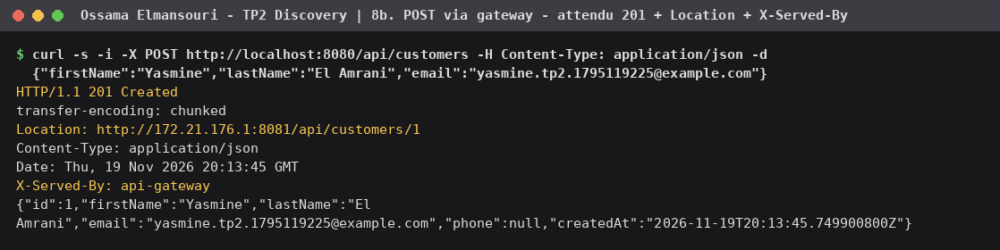 | Création d'un client via la gateway → 201 |
| 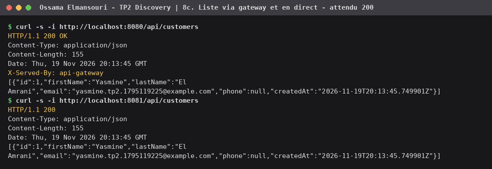 | Liste via la gateway et en direct |
| 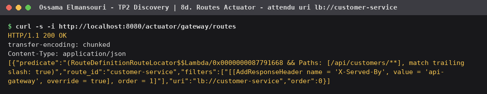 | Route Actuator avec `lb://customer-service` |
| 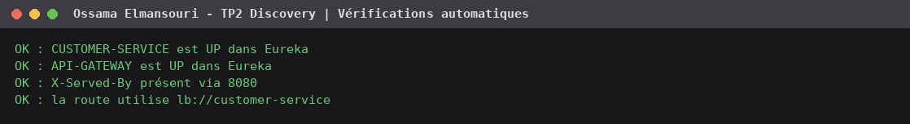 | Vérifications automatiques : toutes OK |

### Section 10 : option Discovery Locator

| Vérification | Résultat |
|---|---|
| `GET /api/customers` (route explicite) | `200` + `X-Served-By: api-gateway` |
| `GET /customer-service/api/customers` (route générée) | `200`, mêmes données, sans `X-Served-By` (normal : le filtre est attaché à la route explicite) |
| `GET /customer-service/customers` | `404` : après le `RewritePath`, le service reçoit `/customers` au lieu de `/api/customers` |
| `/actuator/gateway/routes` | Route explicite `customer-service` + route générée `ReactiveCompositeDiscoveryClient_CUSTOMER-SERVICE` (`Path=/customer-service/**`, `RewritePath`, `uri: lb://CUSTOMER-SERVICE`) |

| Capture | Contenu |
|---|---|
| 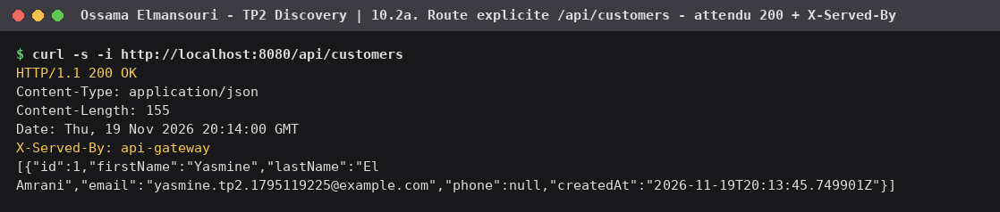 | Route explicite |
| 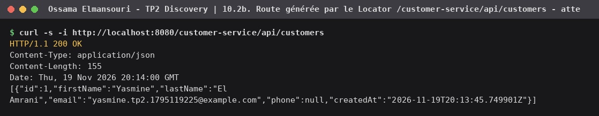 | Route générée par le Locator |
| 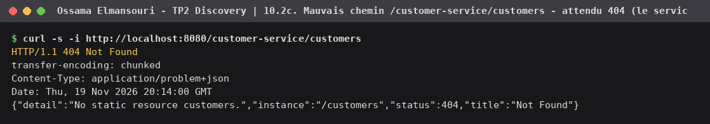 | Mauvais chemin → 404 |
| 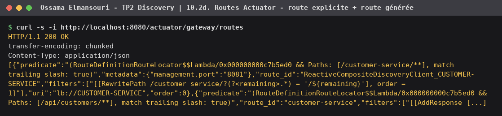 | Les deux routes dans Actuator |
| 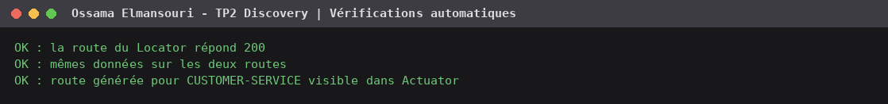 | Vérifications automatiques : toutes OK |

Les sorties brutes sont dans [`captures/`](captures/) : `05-tests-route-explicite.txt`, `07-tests-locator.txt` et les logs de démarrage des trois services. La capture du tableau de bord a été prise avec Edge en mode headless ; les autres images reprennent les sorties des tests.

## Dépannage rencontré

**Symptôme.** Au premier lancement, Eureka affichait bien les deux services UP, mais chaque appel à `http://localhost:8080/api/customers` renvoyait **500**. Le log de la gateway (`captures/00-erreur-500-avant-correctif.txt`) indiquait :

```
java.net.UnknownHostException: Failed to resolve 'ossamaelm06.mshome.net'
```

**Cause.** Par défaut, une instance s'inscrit dans Eureka avec le **nom de la machine**. Sur ce PC, ce nom (`ossamaelm06.mshome.net`, suffixe ajouté par Windows/Hyper-V) ne se résout pas en adresse IP. LoadBalancer choisissait donc la bonne instance, mais la gateway ne pouvait pas la joindre.

**Correction.** `eureka.instance.prefer-ip-address=true` dans `customer-service` et `api-gateway` : les instances s'inscrivent avec leur adresse IP (`172.21.176.1`), et les appels passent en `200`/`201`. Ce cas montre la différence entre le plan de contrôle (inscription : OK) et le plan de données (appel HTTP : en échec).

## Comparaison : route explicite `lb://` et Locator

- **LoadBalancer** décide **quelle instance** appeler. Le **Locator** décide **quelles routes** créer. Les deux fonctionnent ensemble : les routes générées utilisent aussi `lb://`.
- La route explicite garde un contrat public stable (`/api/customers`) et ses propres filtres.
- Le Locator expose par défaut **tous** les services découverts, avec un chemin qui contient le nom du service (`/customer-service/...`). Il convient pour observer ou pour des accès internes, avec un filtrage des services exposés (`include-expression`).
- Pour TicketFlow, la route explicite reste le contrat principal.

## Bilan

- La gateway ne connaît plus l'adresse de `customer-service` : elle la demande au registre. Changer de port ou ajouter une instance ne demande plus de modifier la gateway.
- Eureka sert au plan de contrôle (inscription, heartbeats, lecture du registre). Les requêtes métier ne passent pas par lui.
- **Limite** : un seul registre Eureka, sans réplique. S'il s'arrête, les clients gardent leur cache un moment, mais aucune nouvelle instance ne peut être découverte.
