# TP3 — Configuration centralisée avec Config Server et GitHub

**Auteur : Ossama Elmansouri**
Module : Architecture microservices (Pr. Ahaidous), 2026/2027

## Objectif

Sortir la configuration de TicketFlow du code : les fichiers de configuration sont versionnés dans GitHub, `config-server` (port 8888) les lit et les sert aux applications. On prouve ensuite qu'une valeur métier peut changer **sans redémarrer** `customer-service`.

```
Configuration : GitHub (ticketflow-config) → config-server :8888 → customer-service, api-gateway
Découverte    : api-gateway + customer-service ↔ discovery-server (Eureka) :8761
Trafic métier : client → api-gateway :8080 → customer-service :8081
```

Config Server n'est ni un registre ni un proxy : il n'est pas client Eureka, et `discovery-server` garde sa configuration locale (pas de dépendance circulaire au démarrage).

## Écart par rapport à l'énoncé : emplacement du dépôt de configuration

L'énoncé demande un dépôt GitHub séparé, `ticketflow-config`. Ce dépôt n'a pas encore été créé sur le compte GitHub. Les fichiers de configuration sont donc dans le dossier [`ticketflow-config/`](../ticketflow-config/) **à la racine du dépôt Ticketflow**, à côté des dossiers des TP et non à l'intérieur de `tp3/`. Config Server lit ce dossier avec deux variables d'environnement :

```bash
export CONFIG_GIT_URI=https://github.com/ossamaelmansouri/Ticketflow.git
export CONFIG_SEARCH_PATHS=ticketflow-config
```

Le fichier `application.yml` de config-server lit `search-paths: ${CONFIG_SEARCH_PATHS:}`, vide par défaut. Pour passer au dépôt séparé de l'énoncé, il suffit de créer `ticketflow-config` sur GitHub, d'y pousser les mêmes fichiers à la racine, puis de lancer config-server avec `CONFIG_GIT_URI=https://github.com/ossamaelmansouri/ticketflow-config.git` sans `CONFIG_SEARCH_PATHS`. Aucune autre ligne ne change.

Le reste du TP est conforme : branche `main`, fichiers nommés d'après `spring.application.name`, un commit Git pour chaque changement de configuration.

## Travail réalisé

| Section | Fichier | Modification |
|---|---|---|
| 2 | `ticketflow-config/application.yml` | Propriétés partagées : URL Eureka, `prefer-ip-address` |
| 2 | `ticketflow-config/customer-service.yml` | Port 8081, Actuator `health,info,refresh`, `ticketflow.message` |
| 3 | `ticketflow-config/api-gateway.yml` | Port 8080, route explicite `lb://customer-service`, Locator désactivé, Actuator gateway en lecture seule |
| 4 | `pom.xml` + `services/config-server/` | Module `config-server` : `spring-cloud-config-server`, Actuator, `@EnableConfigServer` |
| 5 | `config-server/.../application.yml` | Port 8888, backend Git `${CONFIG_GIT_URI}`, label `main`, `clone-on-start`, `refresh-rate: 0` |
| 6 | POM de `customer-service` et `api-gateway` | `spring-cloud-starter-config` |
| 6 | `customer-service/.../application.properties` | Seulement le nom, l'import obligatoire `configserver:http://localhost:8888`, le label et JPA |
| 6 | `api-gateway/.../application.yml` | Configuration minimale : nom, import, label |
| 7 | `controllers/ConfigDemoController.java` | `GET /api/config/message`, bean `@RefreshScope` |
| 9 | `ticketflow-config/customer-service.yml` | Message v1 → v2 (commit poussé) |
| 10 | `ticketflow-config/customer-service-dev.yml` | Profil `dev` |
| 12 | `customer-service/src/test/resources/application.properties` | Tests isolés : `spring.cloud.config.enabled=false`, Eureka désactivé, `ticketflow.message` fourni |
| — | `ticketflow-config/customer-service.yml` | Correctif `eureka.client.refresh.enable: false` (voir « Dépannage rencontré ») |

## Exécution

Depuis `tp3/` :

```bash
export CONFIG_GIT_URI=https://github.com/ossamaelmansouri/Ticketflow.git
export CONFIG_SEARCH_PATHS=ticketflow-config
./mvnw -pl services/config-server spring-boot:run       # 1. 8888 (rester actif)
./mvnw -pl services/discovery-server spring-boot:run    # 2. 8761
./mvnw -pl services/customer-service spring-boot:run    # 3. 8081
./mvnw -pl services/api-gateway spring-boot:run         # 4. 8080

bash scripts/test-tp3.sh config          # section 5
bash scripts/test-tp3.sh initial         # section 8
# git push du message v2, puis :
bash scripts/test-tp3.sh avant-refresh   # section 9 : 8888 en v2, service en v1
bash scripts/test-tp3.sh refresh         # section 9 : POST /actuator/refresh, puis v2
bash scripts/test-tp3.sh profil-dev      # section 10
# relancer customer-service avec -Dspring-boot.run.profiles=dev, puis :
bash scripts/test-tp3.sh service-dev
```

## Résultats obtenus (exécution du 19/11/2026)

### Section 5 : Config Server lit GitHub

`/actuator/health` → `200 UP`. `/customer-service/default/main` et `/api-gateway/default/main` → `200`, `label: main`, `version` = commit Git lu. `propertySources` contient le fichier du service **et** `application.yml` partagé (`server.port`, `eureka.client.service-url.defaultZone`, `ticketflow.message`).

| Capture | Contenu |
|---|---|
| 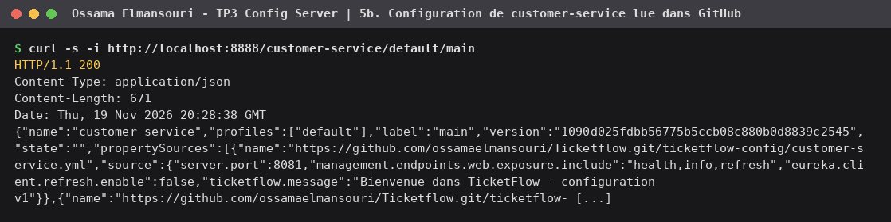 | Configuration de customer-service servie par 8888 |
| 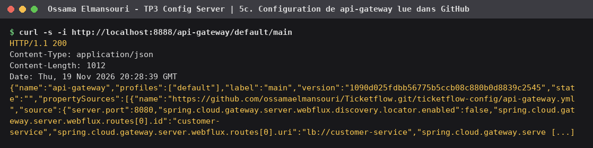 | Configuration de api-gateway (route `lb://`) |
| 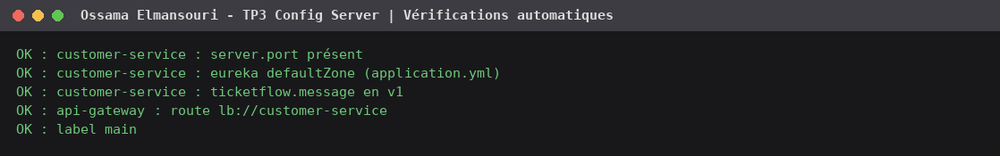 | Vérifications : toutes OK |

### Section 8 : démarrage avec la configuration de GitHub

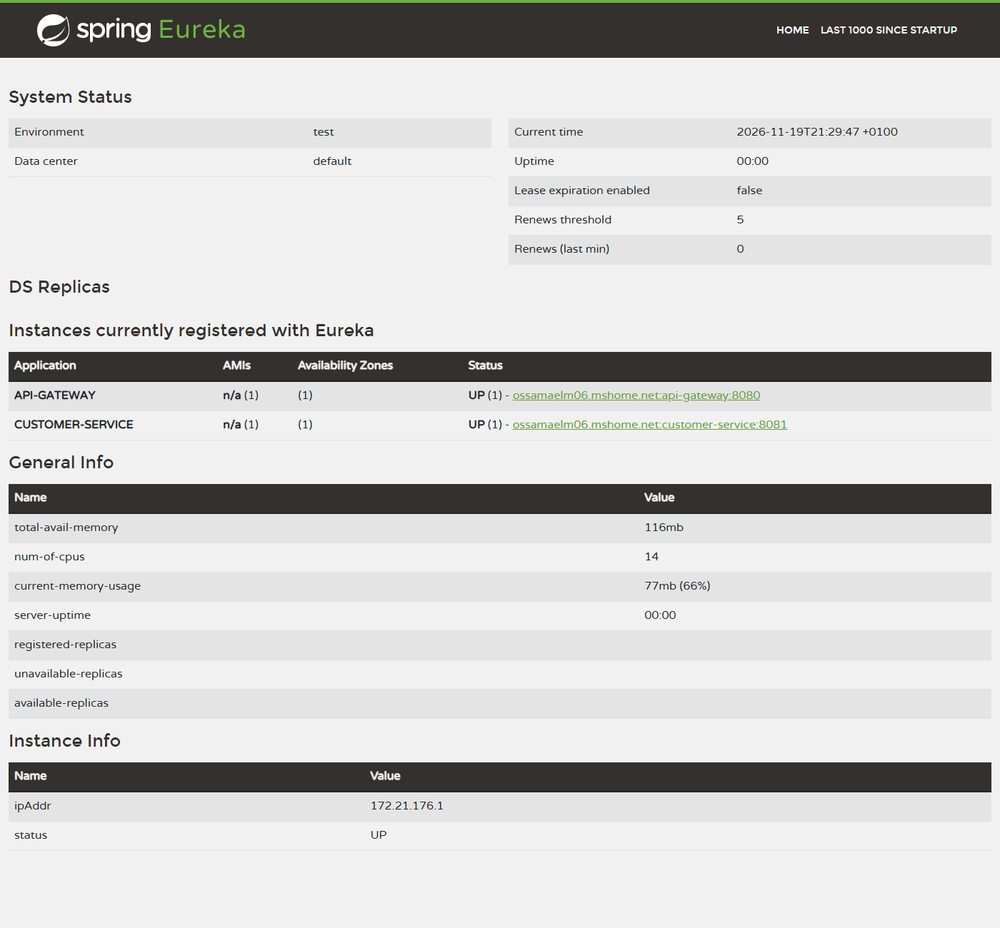

*CUSTOMER-SERVICE et API-GATEWAY sont UP. Config Server n'apparaît pas dans le registre, comme attendu.*

| Capture | Contenu |
|---|---|
| 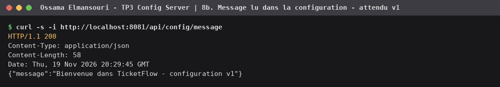 | `GET /api/config/message` sur 8081 → v1 |
| 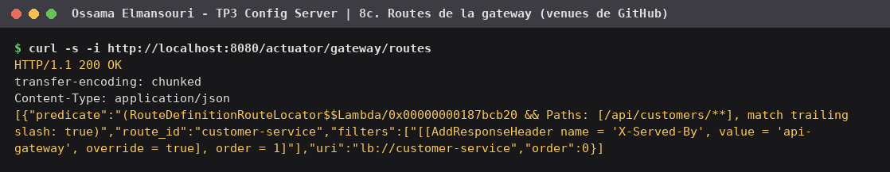 | Route de la gateway venue de GitHub : `lb://customer-service` |
| 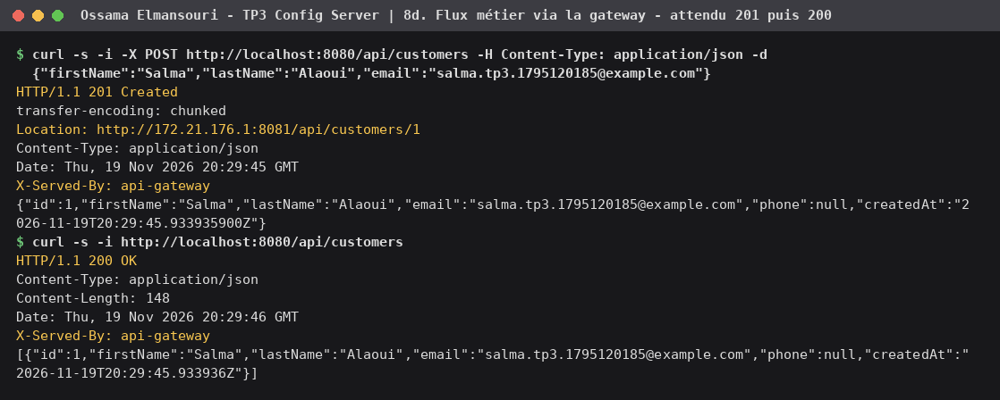 | Flux métier via 8080 : POST 201 (Salma), GET 200, `X-Served-By` |
| 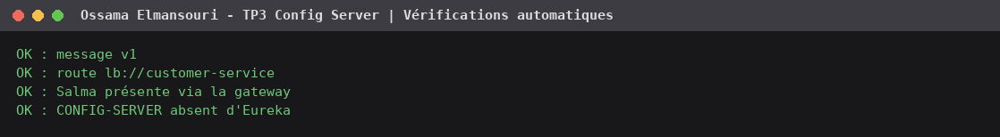 | Vérifications : toutes OK |

### Section 9 : modifier GitHub sans redémarrer

| Moment | Config Server (8888) | Service (8081) |
|---|---|---|
| Démarrage | v1 | **v1** |
| Après `git push` de v2, avant refresh | v2 | **v1** |
| Après `POST /actuator/refresh` (200, clés `config.client.version`, `ticketflow.message`) | v2 | **v2** |

Aucun processus n'a été arrêté : Salma est toujours dans la liste après le refresh.

| Capture | Contenu |
|---|---|
| 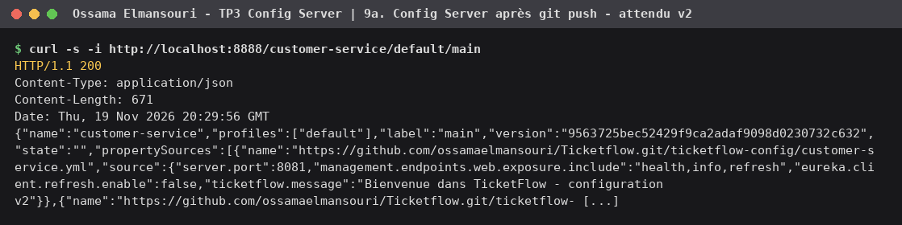 | Après le push : 8888 sert v2 |
| 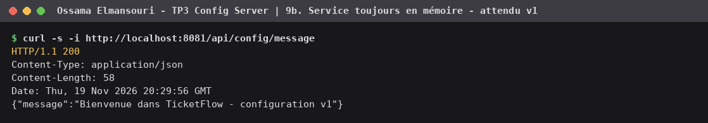 | Le service répond encore v1 |
| 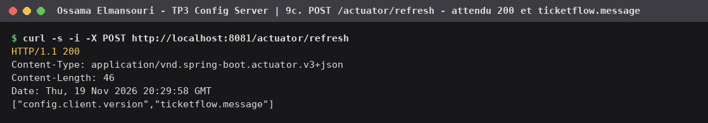 | `POST /actuator/refresh` → 200 + clés modifiées |
| 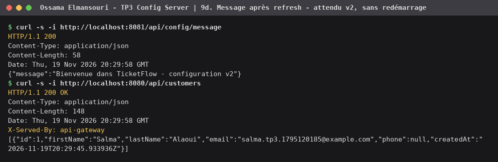 | Message v2, Salma toujours présente |

### Section 10 : profil dev

| Capture | Contenu |
|---|---|
| 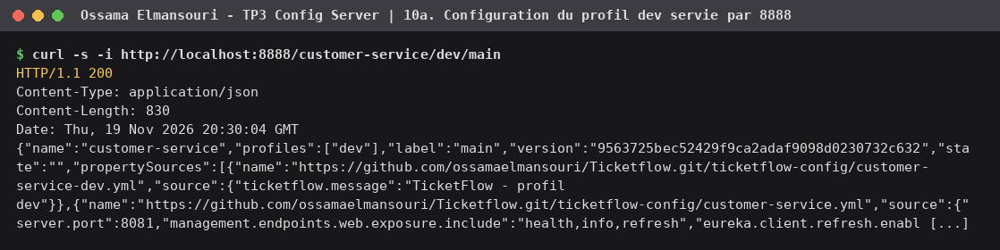 | `/customer-service/dev/main` : le fichier `-dev` l'emporte |
| 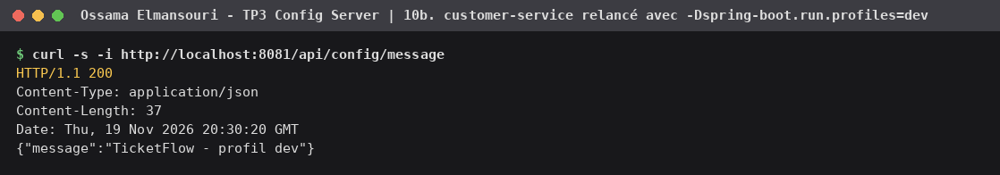 | Service relancé avec `profiles=dev` → « TicketFlow - profil dev » |

### Tests unitaires (section 12)

`./mvnw -pl services/customer-service test` : **7 tests, 0 échec, BUILD SUCCESS** (`captures/07-tests-unitaires.txt`), sans Config Server ni Eureka démarrés.

Les sorties brutes sont dans [`captures/`](captures/) : fichiers `01` à `07`, logs `log-*.log`, et `00-git-push.txt` avec les commits poussés. Le tableau de bord Eureka est une capture Edge headless ; les autres images reprennent les sorties des tests.

## Dépannage rencontré

**Symptôme.** Au premier passage, `POST /actuator/refresh` répondait **500** (`captures/00-refresh-500-avant-correctif.txt`). Le message passait quand même en v2.

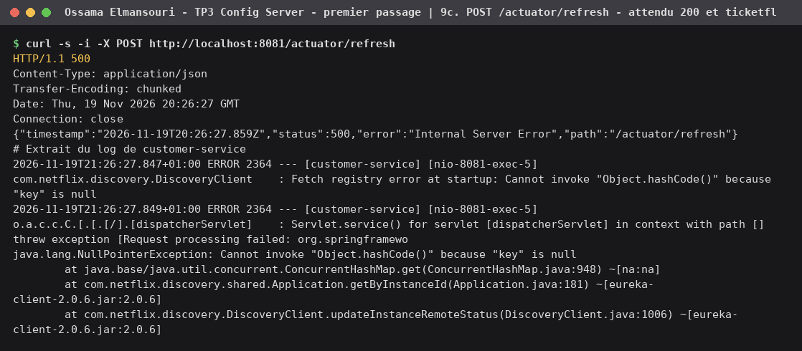

**Cause.** Le log montre `NullPointerException` dans `DiscoveryClient.updateInstanceRemoteStatus`, appelé depuis `RefreshScope.refreshAll`. Par défaut, le refresh recrée aussi le **client Eureka**, et cette recréation échoue. Le bean `ConfigDemoController` était bien recréé (d'où la v2), mais la réponse globale était une erreur.

**Correction.** `eureka.client.refresh.enable: false` dans `ticketflow-config/customer-service.yml`. Le client Eureka n'est plus recréé pendant un refresh, ce qui n'est pas nécessaire pour recharger `ticketflow.message`. Le message est revenu en v1 (commit dédié) pour rejouer tout le scénario. Au second passage, `POST /actuator/refresh` répond **200** avec la liste des clés modifiées.

## Bilan

- La configuration est centralisée et versionnée : chaque changement est un commit Git, visible dans l'historique.
- `refresh-rate: 0` fait relire Git à chaque requête de config, mais **ne pousse rien** vers les applications. Il faut un `POST /actuator/refresh` sur chaque instance concernée (ou un mécanisme comme Spring Cloud Bus).
- `@RefreshScope` suffit pour une propriété simple. Un port, une DataSource ou les routes de la gateway demandent un redémarrage contrôlé.
- **Sécurité** : Config Server expose la configuration en HTTP. Aucun secret n'est dans les fichiers. Pour un dépôt privé, il faut un jeton passé par variable d'environnement (`CONFIG_GIT_TOKEN`), jamais commité.
