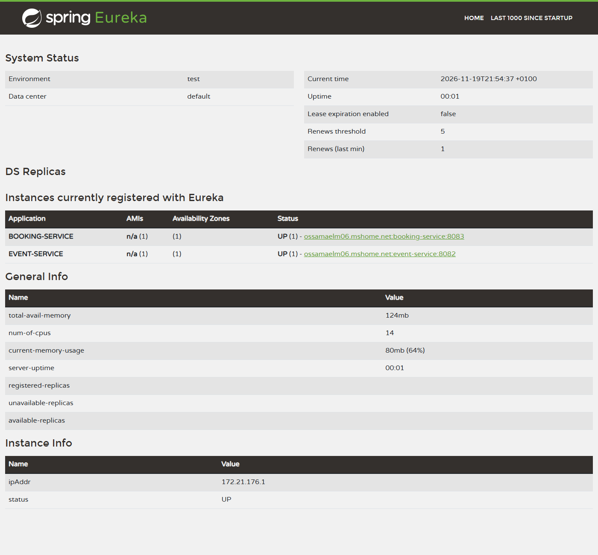
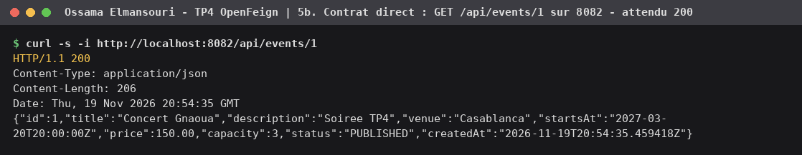
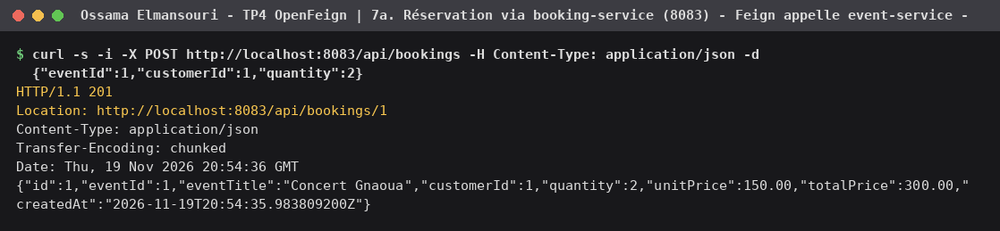
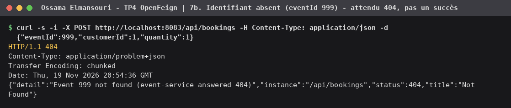
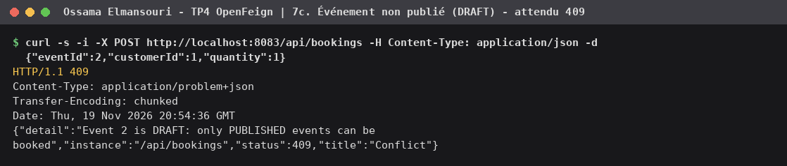
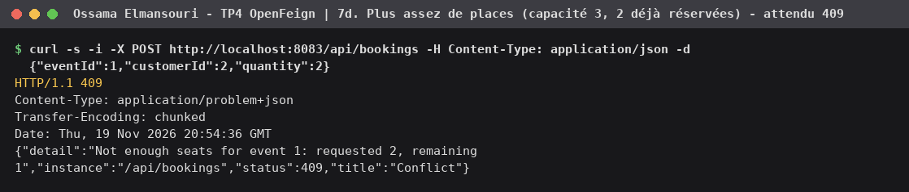
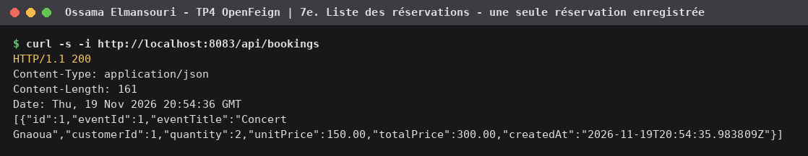
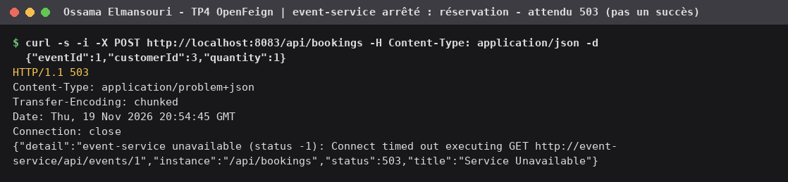
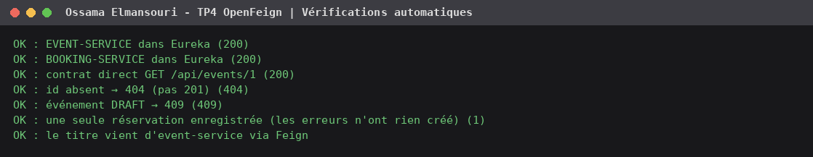
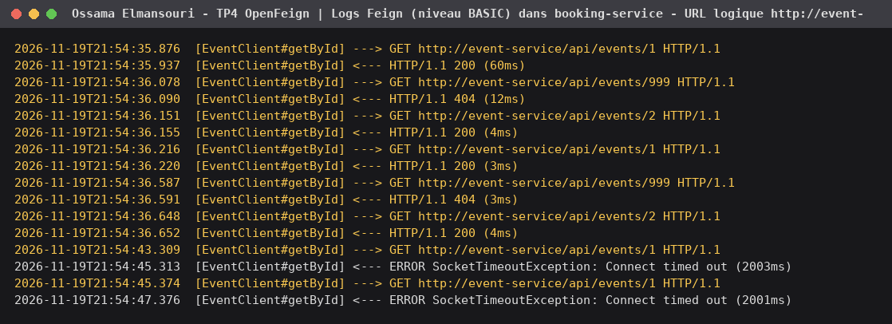

# TP4 — Communication interservices avec Spring Cloud OpenFeign

**Auteur : Ossama Elmansouri**
Module : Architecture microservices (Pr. Ahaidous), 2026/2027

## Objectif

`booking-service` vérifie qu'un événement existe auprès d'`event-service` avant d'enregistrer une réservation. L'appel est déclaré par une interface Java OpenFeign, et le service cible est trouvé par son **nom Eureka**, sans adresse fixe et sans passer par la gateway.

```
client ──► booking-service :8083 ──EventClient (OpenFeign)──► event-service :8082
                    │        GET http://event-service/api/events/{id}
                    └── Eureka + Spring Cloud LoadBalancer résolvent « event-service »
```

## Point de départ et prérequis

- État final du TP3 (Config Server, Eureka, gateway, customer-service).
- **event-service** : l'énoncé le donne comme prérequis (« les deux applications existent déjà »). Il est repris de la branche du cours `feature/step-04-event-service`, puis adapté au TP3 : client Config, propriétés dans `ticketflow-config/event-service.yml` (port 8082), tests isolés de Config Server et d'Eureka.
- **booking-service** n'existait pas dans le projet : il a été écrit pour ce TP (réservation simple : événement, client, nombre de places, prix copié depuis l'événement).

## Travail réalisé

| Section | Fichier | Contenu |
|---|---|---|
| 2 | `booking-service/pom.xml` | `spring-cloud-starter-openfeign` + Eureka Client (qui apporte LoadBalancer) + Config Client |
| 3 | `BookingServiceApplication.java` | `@EnableFeignClients` |
| 3 | `clients/EventClient.java` | `@FeignClient(name = "event-service")`, `@GetMapping("/api/events/{id}")`, **sans** attribut `url` |
| 1 | `clients/EventResponse.java` | Copie des champs **réels** du record `EventResponse` d'event-service (id, title, description, venue, startsAt, price, capacity, status, createdAt). Le statut est un `String` pour ne pas dépendre de l'enum interne |
| 4 | `service/BookingService.java` | `EventClient` injecté dans le service métier (pas dans le contrôleur) ; `validateEvent()` appelé avant l'enregistrement |
| 4 | `controllers/BookingController.java` | `POST /api/bookings` (201 + Location), `GET /api/bookings`, `GET /api/bookings/{id}` |
| 7 | `exceptions/*` | Traduction explicite des erreurs distantes en réponses `application/problem+json` |
| 6 | `ticketflow-config/booking-service.yml` | Port 8083, `connectTimeout: 2000`, `readTimeout: 3000`, logs Feign `basic` (sans corps ni en-têtes) |
| — | `src/test/...` | 5 tests unitaires du cas métier avec un `EventClient` simulé, test de démarrage du contexte |
| — | `scripts/test-tp4.sh` | Scénario complet : nominal, id absent, DRAFT, plus de places, event-service arrêté |

### Comment booking-service présente les erreurs d'event-service

| Situation | Réponse d'event-service | Ce que Feign lève | Réponse de booking-service |
|---|---|---|---|
| Événement publié, places disponibles | 200 | — | **201** Created |
| Identifiant absent | 404 | `FeignException.NotFound` | **404** « Event 999 not found (event-service answered 404) » |
| Événement en brouillon | 200, `status: DRAFT` | — | **409** « only PUBLISHED events can be booked » |
| Plus assez de places | 200 | — | **409** « requested 2, remaining 1 » |
| event-service arrêté | pas de réponse | `RetryableException` (délai de connexion dépassé) | **503** « event-service unavailable » |

Une erreur distante n'est **jamais** transformée en succès, et aucune réservation n'est enregistrée dans ces cas. Le 404 garde son sens (la ressource demandée n'existe pas). Une panne d'event-service devient 503, ce qui distingue « événement inconnu » de « service indisponible ».

## Exécution

Depuis `tp4/`, avec la configuration du TP3 :

```bash
export CONFIG_GIT_URI=https://github.com/ossamaelmansouri/Ticketflow.git
export CONFIG_SEARCH_PATHS=ticketflow-config
./mvnw -DskipTests install
./mvnw -pl services/config-server spring-boot:run
./mvnw -pl services/discovery-server spring-boot:run
./mvnw -pl services/event-service spring-boot:run       # 8082
./mvnw -pl services/booking-service spring-boot:run     # 8083
bash scripts/test-tp4.sh nominal
# arrêter event-service, puis :
bash scripts/test-tp4.sh sans-event
./mvnw -pl services/booking-service,services/event-service test
```

## Résultats obtenus (exécution du 19/11/2026)



*EVENT-SERVICE et BOOKING-SERVICE sont inscrits dans Eureka.*

| Capture | Contenu |
|---|---|
|  | Contrat direct : `GET /api/events/1` sur 8082 → 200 |
|  | Réservation → 201, titre et prix lus dans event-service via Feign |
|  | Identifiant absent → 404 (pas un succès) |
|  | Événement DRAFT → 409 |
|  | Plus assez de places → 409 |
|  | Une seule réservation enregistrée |
|  | event-service arrêté → 503 |
|  | Vérifications automatiques : toutes OK |

### Preuve de la résolution par nom et des délais



Les logs Feign de booking-service (`captures/04-logs-feign.txt`) montrent :

- l'URL appelée est `http://event-service/api/events/{id}` : un **nom logique**, résolu par Eureka et LoadBalancer, sans adresse d'instance dans le code ;
- après l'arrêt d'event-service, son instance est encore dans le cache Eureka de booking-service. L'appel échoue donc après **2003 ms**, ce qui correspond au `connectTimeout: 2000` de la configuration. Sans ce délai, la requête resterait bloquée plus longtemps.

### Tests unitaires

`./mvnw -pl services/booking-service,services/event-service test` : **booking-service 6 tests, event-service 21 tests, 0 échec, BUILD SUCCESS** (`captures/03-tests-unitaires.txt`).

## Dépannage rencontré

**1. Compilation d'event-service impossible avec le JDK 25.** Le premier build échouait : `cannot find symbol: method getId()` dans `EventResponse` (`captures/00-build-lombok-avant-correctif.txt`). event-service utilise Lombok. Depuis le JDK 23, javac n'exécute plus les processeurs d'annotations trouvés sur le classpath, et la machine de test a un JDK 25. **Correction** : déclarer Lombok dans `annotationProcessorPaths` du `maven-compiler-plugin` (pom d'event-service).

**2. Données de test et encodage.** Au premier passage du script, la création de l'événement répondait 400 (`Failed to read request`). Le JSON contenait « Soirée », et Git Bash sous Windows le transmettait à curl dans un encodage non UTF-8. Le texte a été remplacé par « Soiree » dans le script. Ce problème venait du script de test, pas des services.

## Bonnes pratiques appliquées et limites

- OpenFeign est **synchrone** : la requête de réservation attend la réponse. Les délais de connexion et de lecture bornent cette attente.
- Les logs Feign sont en `BASIC` : méthode, URL, statut et durée, sans corps ni en-têtes.
- Pas de nouvelle tentative automatique : `POST /api/bookings` n'est pas idempotent, et rejouer une réservation pourrait la créer deux fois.
- Le contrôle du nombre de places est simple : deux réservations simultanées peuvent passer le contrôle en même temps. Une vraie solution demanderait un verrou ou un stock géré par booking-service.
- La résilience face à une panne durable (disjoncteur, repli) n'est pas traitée ici. C'est le rôle de Resilience4j.
