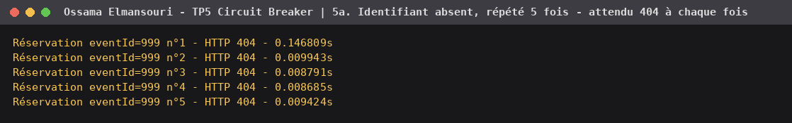
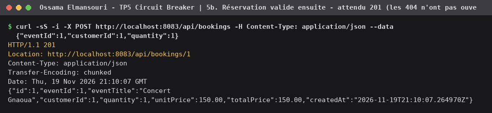
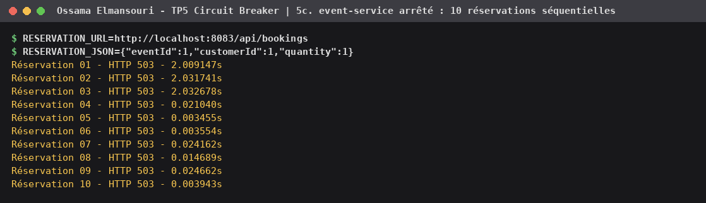
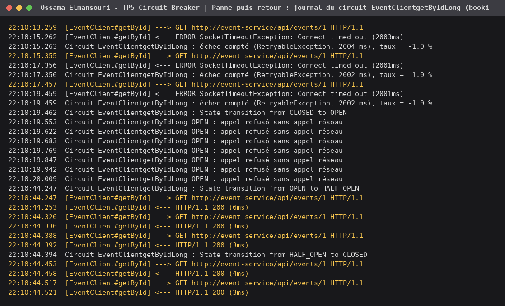
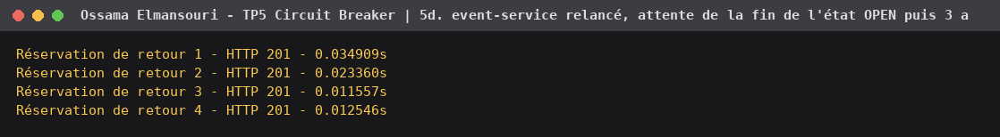
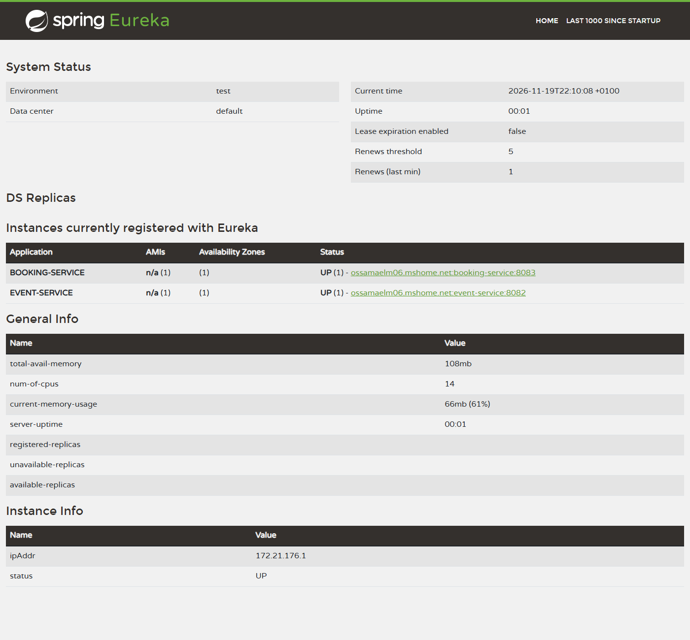
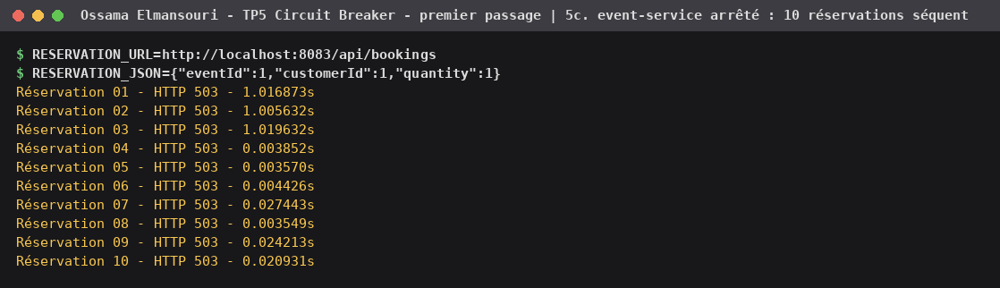

# TP5 — Circuit Breaker avec Resilience4j

**Auteur : Ossama Elmansouri**
Module : Architecture microservices (Pr. Ahaidous), 2026/2027

## Objectif

Protéger la réservation lorsque `event-service` devient indisponible : un circuit breaker Resilience4j entoure l'appel OpenFeign `EventClient#getById(Long)`. Après un nombre déterminé d'échecs, le circuit s'ouvre et les appels sont refusés **immédiatement, sans appel réseau**. Les 404 ne comptent pas comme des pannes. Une panne n'est jamais présentée comme une réservation confirmée.

```
CLOSED ──(taux d'échec ≥ 50 % sur ≥ 5 appels)──► OPEN ──(10 s, puis appel suivant)──► HALF_OPEN
   ▲                                                                                       │
   └──────────────────────── 3 appels de test réussis ─────────────────────────────────────┘
                                 (échec → retour en OPEN)
```

Point de départ : état final du TP4 (booking-service + EventClient OpenFeign).

## Travail réalisé

| Section | Fichier | Contenu |
|---|---|---|
| 2 | `booking-service/pom.xml` | `spring-cloud-starter-circuitbreaker-resilience4j`, sans version (BOM Spring Cloud) |
| 3 | `booking-service.yml` (dépôt ticketflow-config) | `spring.cloud.openfeign.circuitbreaker.enabled: true`, identifiants alphanumériques, seuils `ticketflow.resilience.event-service.*`, délais Feign `default` (2000 / 3000 ms) |
| 3 | `config/EventServiceResilienceProperties.java` | Lecture typée des seuils (fenêtre 10, minimum 5, 50 %, OPEN 10 s, 3 appels HALF_OPEN, limite 4 s) |
| 3 | `config/ResilienceConfig.java` | Configuration de l'instance `EventClientgetByIdLong` : fenêtre par nombre d'appels, **404 et 400 ignorés**, limite de temps, journal des transitions et des rejets |
| 4 | `service/BookingService.java` | L'erreur est extraite de `NoFallbackAvailableException` (pas de repli). 404 → 404 ; circuit ouvert (`CallNotPermittedException`) ou panne (`RetryableException`, délai, 5xx) → 503 |
| 4 | `exceptions/ApiExceptionHandler.java` | Gestionnaires de la section 4 (`FeignException.NotFound` → 404, `RetryableException` / `CallNotPermittedException` → 503) ajoutés comme filet de sécurité |
| — | `src/test/...` | `ResilienceConfigTest` (règles du circuit avec les seuils du TP) et deux tests de traduction des erreurs |
| 5 | `scripts/test-tp5.sh` | Exercice : 404 ignorés, panne avec 10 appels mesurés, retour en HALF_OPEN puis CLOSED |

Aucun repli ne renvoie un événement « disponible », et aucune réservation n'est confirmée pendant une panne.

## Exécution

Depuis `tp5/`, avec la configuration du TP3 (dépôt [ticketflow-config](https://github.com/ossamaelmansouri/ticketflow-config)) :

```bash
export CONFIG_GIT_URI=https://github.com/ossamaelmansouri/ticketflow-config.git
./mvnw -DskipTests install
./mvnw -pl services/config-server spring-boot:run
./mvnw -pl services/discovery-server spring-boot:run
./mvnw -pl services/event-service spring-boot:run
./mvnw -pl services/booking-service spring-boot:run

bash scripts/test-tp5.sh preparation    # événement 1 publié
bash scripts/test-tp5.sh ignore-404     # 5 × 404 puis une réservation valide
# arrêter event-service
bash scripts/test-tp5.sh panne          # 10 réservations séquentielles
# relancer event-service, refaire « preparation », attendre plus de 10 s
bash scripts/test-tp5.sh retour
```

## Résultats obtenus (exécution du 19/11/2026)

### 1. Les 404 n'ouvrent pas le circuit

Cinq réservations sur l'événement 999 → **404** à chaque fois. La réservation valide suivante → **201** : elle a bien atteint event-service. Le journal montre « erreur ignorée (NotFound) » pour chaque 404.

| Capture | Contenu |
|---|---|
|  | 5 × 404, réponse rapide |
|  | Réservation valide ensuite → 201 |

### 2. event-service arrêté : 10 réservations séquentielles

| Appel | Statut | Durée | État du circuit |
|---|---|---|---|
| 01 | 503 | 2,01 s | CLOSED, appel tenté (délai de connexion de 2 s) |
| 02 | 503 | 2,03 s | CLOSED, appel tenté |
| 03 | 503 | 2,03 s | CLOSED → **OPEN** après cet échec |
| 04 à 10 | 503 | 0,003 à 0,025 s | OPEN : **refus immédiat, sans appel réseau** |



Les dix réponses sont des 503 : aucune réservation n'est confirmée. Le gain du circuit se voit dans les durées : chaque appel tenté attend 2 s, chaque appel refusé répond en quelques millisecondes.

**Pourquoi le circuit s'ouvre au 3e échec, et non au 5e comme dans le calcul de l'énoncé.** La fenêtre glissante contient aussi les appels réussis qui précèdent la panne. Avant l'arrêt d'event-service, deux réservations valides avaient réussi (étape 1). Au 3e échec, la fenêtre compte 5 appels (2 succès + 3 échecs), soit 60 % d'échecs, au-dessus du seuil de 50 %. Avec un circuit neuf (aucun succès dans la fenêtre), il faudrait 5 échecs. C'est ce que vérifie `ResilienceConfigTest.opensOnFifthConsecutiveFailure`. Le tableau de l'énoncé annonce une ouverture au 4e appel, ce qui ne correspond pas à `minimum-number-of-calls: 5` : la configuration fournie a été gardée telle quelle.

### 3. Retour d'event-service : HALF_OPEN puis CLOSED

Après la relance d'event-service et plus de 10 s d'attente, la réservation suivante fait passer le circuit en **HALF_OPEN**. Les **3 appels de test** réussissent, le circuit se referme (**CLOSED**) et les réservations repassent en **201**.



*Journal de booking-service (`captures/07-journal-circuit.txt`) : 3 échecs comptés, transition CLOSED → OPEN, 7 appels refusés sans appel réseau, puis OPEN → HALF_OPEN → CLOSED.*

| Capture | Contenu |
|---|---|
|  | Réservations de retour → 201 |
|  | Services inscrits dans Eureka pendant le test |

### Tests unitaires

`./mvnw -pl services/booking-service test` : **11 tests, 0 échec, BUILD SUCCESS** (`captures/06-tests-unitaires.txt`). Ils vérifient en particulier que 4 échecs laissent le circuit fermé et que le 5e l'ouvre, que 2 échecs sur 5 (40 %) ne l'ouvrent pas, et que 404 et 400 sont ignorés.

## Dépannage rencontré

**Limite de temps restée à 1 s.** Au premier passage, les trois appels tentés pendant la panne duraient **1,0 s** (`captures/00-panne-avant-correctif-limite-1s.txt`) et le journal indiquait `TimeoutException`, alors que la limite configurée est de 4 s et que le délai de connexion est de 2 s.



**Cause.** Dans la version utilisée (Spring Cloud CircuitBreaker 5.0.2), la limite de temps d'une instance est lue dans le `TimeLimiterRegistry`. La valeur passée par `factory.configure(builder -> builder.timeLimiterConfig(...))` n'est pas prise en compte : la valeur par défaut de 1 s s'appliquait. Le code de la classe `Resilience4JCircuitBreakerFactory` (méthode `create`) a été inspecté pour le confirmer.

**Correction.** La limite est enregistrée directement dans le registre : `factory.getTimeLimiterRegistry().addConfiguration("EventClientgetByIdLong", ...)`. Au second passage, l'échec vient bien du délai de connexion Feign (`RetryableException` après 2 s), sous la limite de 4 s.

**Journal dupliqué.** Le customizer du circuit est rappelé à chaque création du wrapper par OpenFeign : les abonnés aux événements s'ajoutaient à chaque appel, et chaque ligne du journal apparaissait plusieurs fois. Ils ne sont maintenant ajoutés qu'une fois par circuit.

## Bilan

- Le circuit breaker ne rend pas une panne plus rapide quand elle est déjà immédiate. Son gain apparaît quand l'appel distant attend un délai : ici 2 s par appel tenté, contre quelques millisecondes une fois le circuit ouvert.
- Ignorer les 404 est essentiel : un client qui demande des événements inexistants ne doit pas couper l'accès à event-service pour tout le monde.
- Les états sont propres à chaque instance de booking-service : avec plusieurs instances, chacune a son propre circuit.
- Le circuit protège booking-service mais ne remplace ni les délais Feign (qui bornent chaque appel) ni une supervision des services.
