# TP6 — Apache Kafka en ligne de commande

**Auteur : Ossama Elmansouri**
Module : Architecture microservices (Pr. Ahaidous), 2026/2027

## Objectif

Démarrer un broker Kafka seul dans Docker (mode **KRaft**, sans ZooKeeper), puis observer les notions du cours avec les scripts de Kafka : topics et partitions, offsets, clés, groupes de consommateurs, rééquilibrage, retard (lag), rétention, compaction et réseau. Les topics sont ceux de TicketFlow, que `notification-service` consommera ensuite avec Spring.

Ce TP ne dépend pas du code Java de TicketFlow. Le dossier `kafka-tp/` est autonome.

## Contenu du dossier

| Fichier | Rôle |
|---|---|
| `kafka-tp/docker-compose.yml` | Broker Kafka 4.0.0, un seul nœud broker + contrôleur, **corrigé** (voir « Dépannage rencontré ») |
| `kafka-tp/docker-compose.enonce.yml` | Version de l'énoncé, conservée pour montrer l'erreur de démarrage |
| `scripts/tp6.sh` | Exécution de tous les exercices. Les terminaux T1, T2… de l'énoncé sont des consommateurs lancés en arrière-plan dans le conteneur, chacun avec un `client.id` distinct (T1, T2, C1…C4). « Ctrl+C » est simulé par l'arrêt du processus |
| `captures/0X-*.txt` | Sortie complète de chaque exercice (commandes et résultats) |
| `captures/capture-*.png` | Les mêmes sorties en images |

Les consommateurs lancés avec `--timeout-ms` s'arrêtent seuls quand plus rien n'arrive. Kafka écrit alors `ERROR ... TimeoutException` puis `Processed a total of N messages` : c'est l'équivalent du Ctrl+C de l'énoncé, pas une erreur du TP.

## Exécution

```bash
cd tp6/kafka-tp && docker compose up -d     # démarrage manuel, comme dans l'énoncé
docker exec -it kafka sh                      # puis : cd /opt/kafka/bin ; export BS=kafka:9092

# ou tout le TP en une fois, depuis tp6/ (Git Bash) :
bash scripts/tp6.sh captures
```

## Résultats obtenus (exécution du 19/11/2026, Docker 29.9.2)

### Démarrage

Le broker démarre (`Kafka Server started`). Le conteneur est `Up` avec le port `0.0.0.0:9092->9094/tcp`.

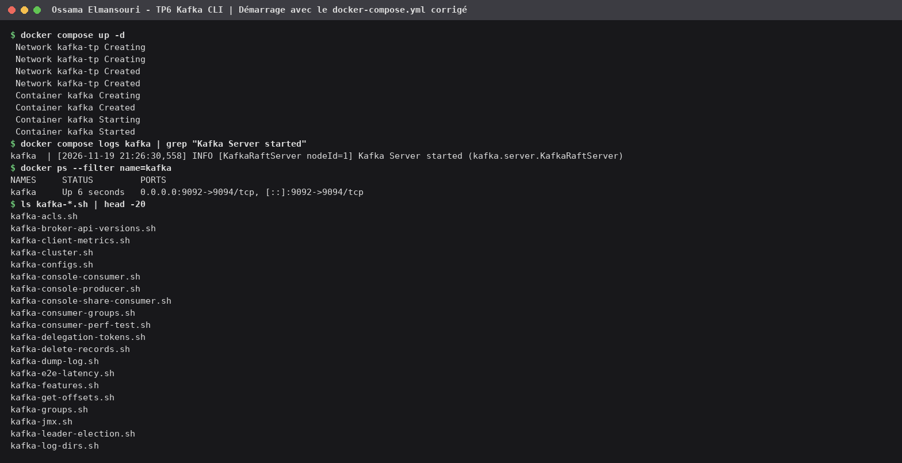

### Exercice 1 — Topics

- `ticketflow.payment.succeeded`, `ticketflow.payment.failed` et `ticketflow.booking.cancelled` sont créés avec 3 partitions chacun. Chaque partition a `Leader: 1, Replicas: 1, Isr: 1` : un seul broker sert et stocke tout.
- Facteur de réplication 3 → erreur *« The target replication factor of 3 cannot be reached because only 1 broker(s) are registered »*. C'est pourquoi la production demande au moins 3 brokers.

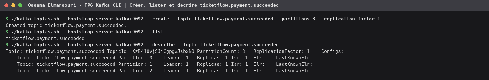
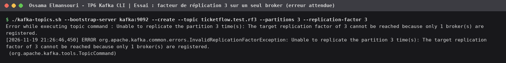

### Exercice 2 — Produire et consommer

Les 3 messages sont lus, puis **relus** avec `--from-beginning` : lire ne supprime rien. Sans `--from-beginning`, **0 message** : sans offset enregistré, un consommateur commence à la fin (`auto.offset.reset=latest`).

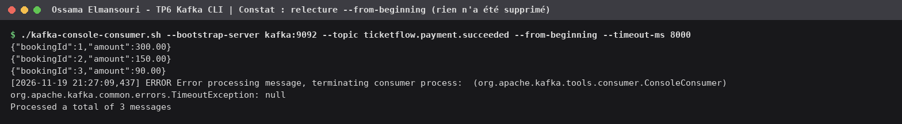
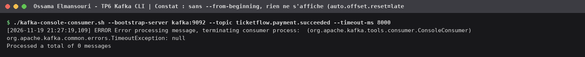

### Exercice 3 — Clés, partitions et offsets

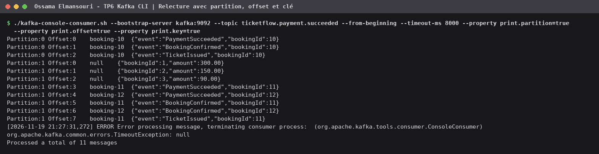

Réponses aux questions :

- **Même clé, même partition, offsets croissants.** `booking-10` est entièrement en partition 0 (offsets 0, 1, 2). `booking-11` et `booking-12` sont en partition 1, chacune dans l'ordre d'envoi.
- **Sans clé, aucune garantie d'emplacement.** Les 3 messages de l'exercice 2 sont tous dans la même partition (1, offsets 0 à 2) : le producteur les a envoyés en un seul lot.
- **Pas d'ordre global entre clés différentes.** La relecture donne la partition 0, puis la partition 1 : l'ordre de saisie (10, 11, 10, 12…) est perdu entre partitions. L'ordre n'est garanti qu'à l'intérieur d'une partition, donc pour une même clé.
- **Offsets de fin** : `0:3`, `1:8`, `2:0`, soit **11 messages** (3 + 8). Offsets de début (`--time -2`) : 0 partout, rien n'a été supprimé. La partition 2 est vide : aucune des trois clés ne tombe dessus.
- **Lecture ciblée** : partition 1, à partir de l'offset 1, 2 messages → offsets 1 et 2.

### Exercice 4 — Groupes de consommateurs et rééquilibrage

| Étape | Résultat observé |
|---|---|
| T1 + T2 dans `notification-service` | **2 + 1** : T1 lit les partitions 0 et 1, T2 la partition 2 ; lag 0 |
| Publication booking-20/21/22 | Chaque clé arrive toujours dans le même terminal : booking-21 (partition 0) dans T1, booking-20 et 22 (partition 2) dans T2. Aucun message reçu deux fois |
| Arrêt de T2 | Rééquilibrage : **T1 possède les 3 partitions**, et reçoit les nouveaux messages des trois clés |
| Relance de T2 | Nouveau rééquilibrage, retour à 2 + 1 |
| T1 et T2 arrêtés, 5 messages publiés | `Consumer group has no active members`, **lag total 5** (1 + 1 + 3) |
| Reprise sans `--from-beginning` | Reçoit **exactement les 5 messages manqués**, puis lag 0. Rien n'est perdu, rien n'est relu |
| Groupe `analytics` | Relit les **25 messages** depuis le début : chaque groupe a ses propres offsets |
| `--reset-offsets --to-earliest` | `--dry-run` affiche les nouveaux offsets sans rien changer, `--execute` les applique. Lag = 7 + 7 + 11 = 25, et la relance relit **25 messages** |
| 4 consommateurs, 3 partitions | `--members` : C1, C2 et C3 ont 1 partition chacun, **C4 en a 0** |

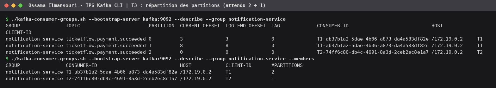
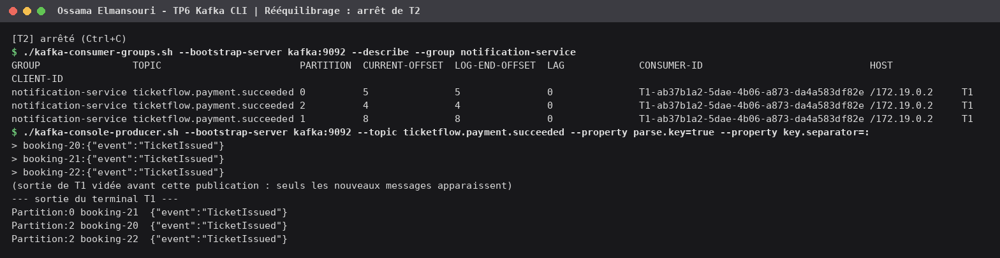
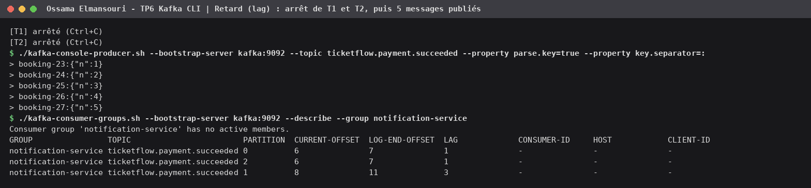
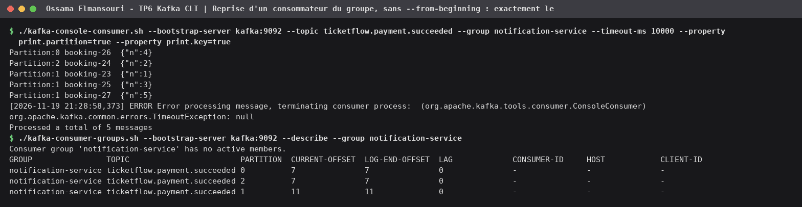
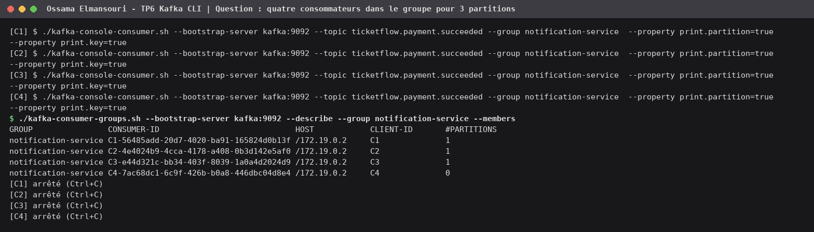

**Question : combien de consommateurs utiles dans un groupe ?** Au plus **3**, le nombre de partitions. Dans un groupe, une partition n'a qu'un seul lecteur. Le 4e membre reste sans partition : il ne sert que de remplaçant si un autre tombe.

### Exercice 5 — Rétention et compaction

- `retention.ms=60000` apparaît comme configuration **dynamique** du topic (`DYNAMIC_TOPIC_CONFIG`), puis disparaît avec `--delete-config` : le topic revient à la valeur par défaut du broker (7 jours).
- Topic compacté `ticketflow.booking.status` : les 3 états de `booking-30` (PENDING, CONFIRMED, CANCELLED) sont tous relus. La compaction ne traite que les segments fermés, à son rythme. Elle garantit seulement que le dernier état de chaque clé est conservé.

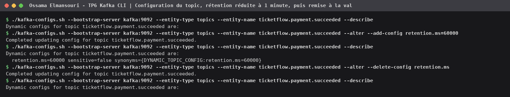
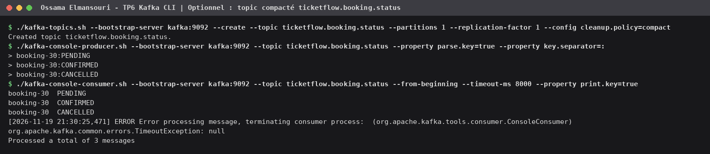

### Exercice 6 — Listeners et réseau Docker

| Test | Résultat |
|---|---|
| `kafka:9092` depuis un conteneur du réseau `kafka-tp` | Liste des topics : **fonctionne** |
| `localhost:9092` depuis ce conteneur | `Connection to node -1 (localhost/127.0.0.1:9092) could not be established`, puis `Timed out waiting for a node assignment` après **62 s**. Dans un conteneur, `localhost` désigne le conteneur lui-même |
| `kafka:9094` (listener EXTERNAL) depuis ce conteneur | La connexion initiale **réussit**, mais le broker annonce `localhost:9092` : `Connection to node 1 (localhost/127.0.0.1:9092)`, puis délai dépassé. C'est exactement le cas décrit par l'énoncé : « parlez-moi sur localhost:9092 » |
| `localhost:9092` depuis la machine hôte | Connexion TCP établie (port publié vers EXTERNAL) |

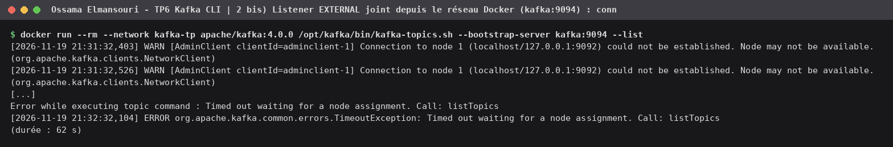

Le message d'erreur distingue les deux cas : `node -1` signifie que l'adresse de départ est injoignable ; `node 1` signifie que l'adresse de départ répond mais que l'adresse **annoncée** est injoignable. Pour Spring : `localhost:9092` pour une application lancée sur la machine, `kafka:9092` pour une application lancée dans Docker Compose.

### Exercice 7 — Scénario TicketFlow

Pour chacune des réservations booking-40, 41 et 42, les trois événements (PaymentSucceeded, BookingConfirmed, TicketIssued) arrivent **dans l'ordre et dans le même terminal**. Ici, les trois clés tombent sur les partitions 0 et 1, toutes deux lues par T1 : T2 (partition 2) ne reçoit rien, ce qui est normal. Après l'arrêt de T1, les trois nouveaux événements de booking-40 arrivent dans **T2**, qui possède désormais toutes les partitions.

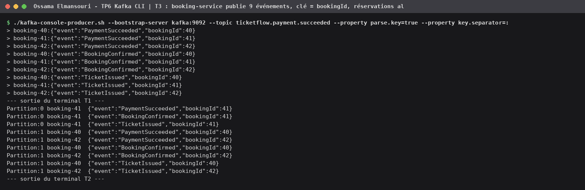
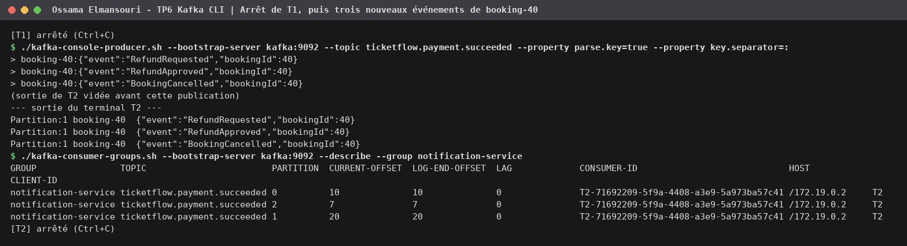

Dans `notification-service`, ce consommateur sera un `@KafkaListener(topics = "ticketflow.payment.succeeded", groupId = "notification-service")`, et le nombre de consommateurs du groupe correspondra au réglage `concurrency`.

### Nettoyage

Les 4 topics sont supprimés. Un topic de test survit à `docker compose stop` puis `start`, et disparaît après `docker compose down` puis `up` : aucun volume n'est déclaré, les données vivent dans le conteneur.

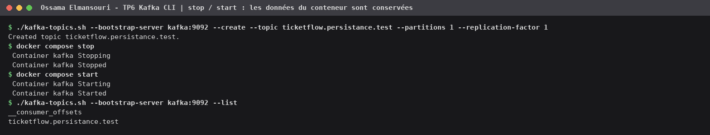

## Dépannage rencontré

**1. Le `docker-compose.yml` de l'énoncé ne démarre pas.** Le conteneur s'arrête aussitôt (`Exited (1)`) avec :

```
java.lang.IllegalArgumentException: requirement failed: Each listener must have a different port,
listeners: PLAINTEXT://:9092,EXTERNAL://:9092,CONTROLLER://:9093
```

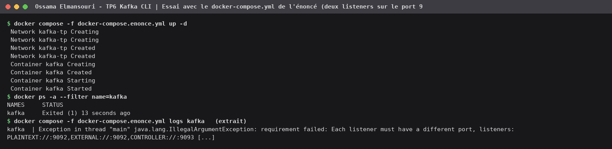

`PLAINTEXT` et `EXTERNAL` écoutent tous deux sur le port 9092 **dans** le conteneur, ce que Kafka refuse. **Correction** : `EXTERNAL` écoute sur 9094 dans le conteneur, et le port 9092 de la machine est relié à ce 9094 (`"9092:9094"`). Les adresses annoncées ne changent pas (`kafka:9092` et `localhost:9092`), donc toutes les commandes de l'énoncé restent valables.

**2. Exercice 6 : deux commandes identiques dans l'énoncé.** La seconde commande, censée échouer, reprend `--bootstrap-server kafka:9092`, qui fonctionne. Le test a été fait avec `localhost:9092`, puis avec `kafka:9094` (listener EXTERNAL), qui reproduit le comportement expliqué dans l'énoncé.

**3. Automatisation (premier passage du script).** Les consommateurs « arrêtés » par le script restaient en réalité actifs, à cause d'un motif `pkill` incorrect. Le groupe ne se rééquilibrait pas, le reset des offsets était refusé (`group is Stable`) et un consommateur oublié recréait un topic supprimé. Le script a été corrigé : il vérifie maintenant qu'il ne reste aucun processus. Les résultats ci-dessus viennent du second passage.

## Bilan

- Un consommateur qui redémarre ne relit pas tout : il reprend à l'offset validé par son groupe. Sans offset validé, `auto.offset.reset` décide (`earliest` ou `latest`).
- Le parallélisme maximal d'un groupe est le nombre de partitions : un 4e consommateur sur 3 partitions reste inactif.
- La clé garantit que tous les messages d'une réservation vont dans la même partition, donc qu'ils sont lus dans l'ordre. Elle ne garantit aucun ordre entre deux réservations.
- Si notification-service traitait un message puis plantait avant de valider son offset, le message serait relu au redémarrage (livraison « au moins une fois ») : le traitement doit être **idempotent**.
- 3 partitions avec 3 répliques demandent au moins 3 brokers : deux répliques d'une même partition ne peuvent pas être sur le même broker.
